# Markdown vs Confluence: Choosing a Documentation Platform

[View screenshots of the Confluence page](#screenshots-of-the-confluence-page)

| Property | Value |
|----------|-------|
| Document type | Comparison and recommendation |
| Audience | Teams starting a documentation project |
| Decision | Use both, for different content |

## Summary
Markdown and Confluence solve different problems. **Markdown** is a simple text format that is easy to version in Git. **Confluence** is a team wiki with editing tools, permissions and comments. Most teams get the best result by using both.

## Comparison
| Criteria | Markdown (with GitHub) | Confluence |
|----------|------------------------|------------|
| Learning curve | Small syntax to learn | Visual editor, very easy |
| Version history | Excellent, through Git | Good, page history |
| Collaboration | Pull requests and reviews | Live editing and comments |
| Non-technical users | Harder | Easy |
| Permissions | Repository level | Space and page level |
| Search | Basic | Strong |
| Diagrams | Mermaid in code blocks | Macros and apps |
| Cost | Free | Paid after small teams |
| Best for | Developer docs, READMEs | Team knowledge, processes |

## Score by use case
Scores from 1 (poor) to 5 (excellent). These are example scores for a small team.

| Use case | Markdown | Confluence |
|----------|:--------:|:----------:|
| Reference guides | 5 | 3 |
| Meeting notes | 2 | 5 |
| Onboarding guides | 3 | 5 |
| Release notes | 5 | 4 |
| Policies and processes | 3 | 5 |

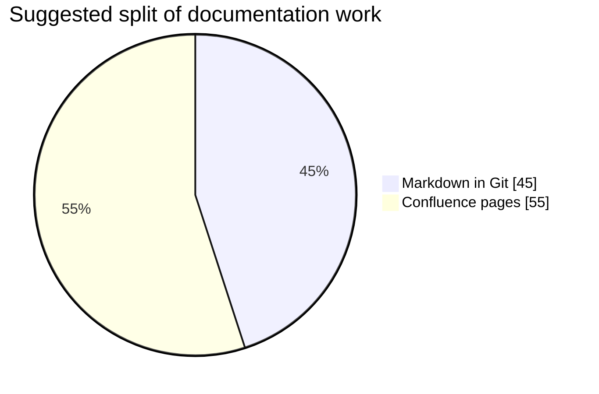

## Decision flow
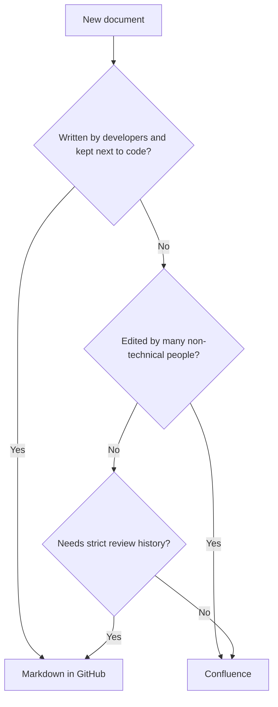

## Markdown quick reference
| Result | Syntax |
|--------|--------|
| Heading | `# Title`, `## Section` |
| **Bold** | `**text**` |
| *Italic* | `*text*` |
| Link | `[text](https://example.com)` |
| Image | `` |
| Code | `` `code` `` |
| List | `- item` or `1. item` |
| Quote | `> note` |

## Recommendation
1. Keep technical and developer docs in **Markdown** inside the code repository.
2. Keep processes, meeting notes and onboarding in **Confluence**.
3. Link the two so readers can move between them.

## Learn more
- [Markdown Guide](https://www.markdownguide.org/)
- [GitHub Flavored Markdown spec](https://github.github.com/gfm/)
- [Confluence documentation](https://confluence.atlassian.com/doc/confluence-documentation-135922.html)
- [Mermaid diagrams](https://mermaid.js.org/)

## Screenshots of the Confluence page

This comparison was designed and published in Confluence. The screenshots below show the final page, from top to bottom.

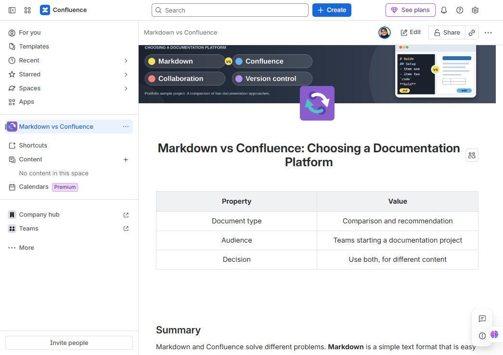

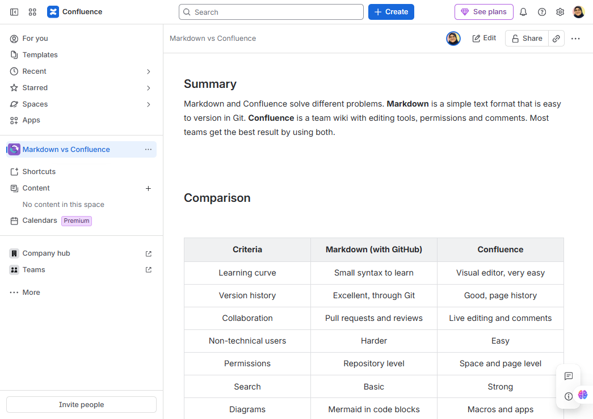

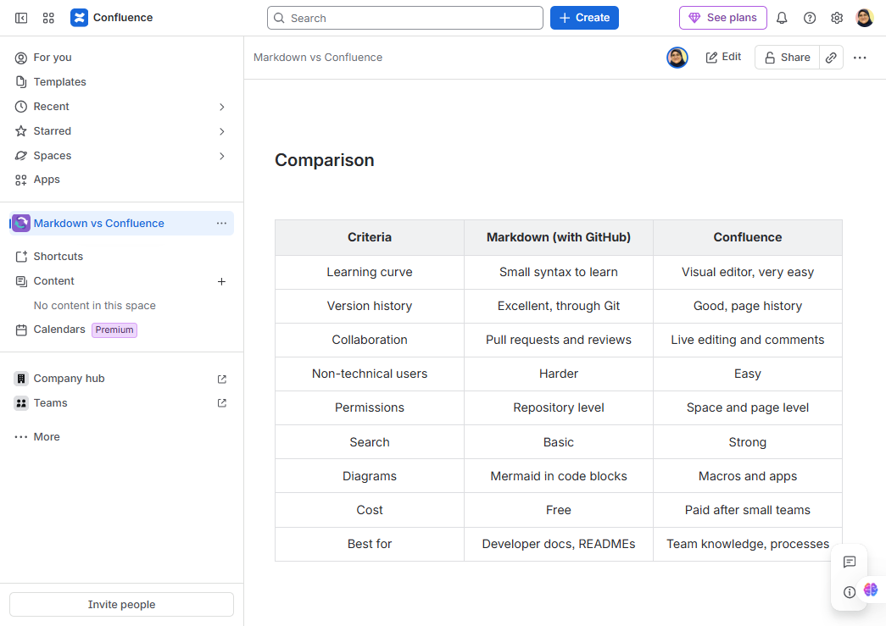

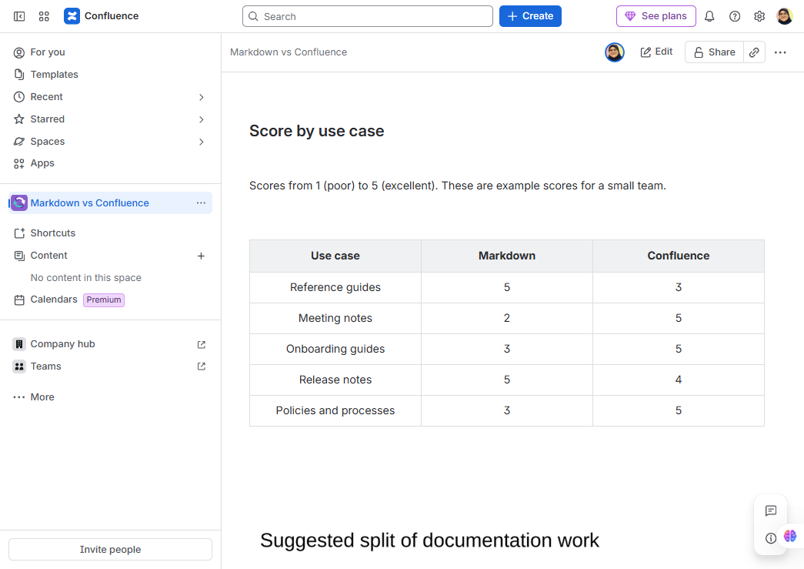

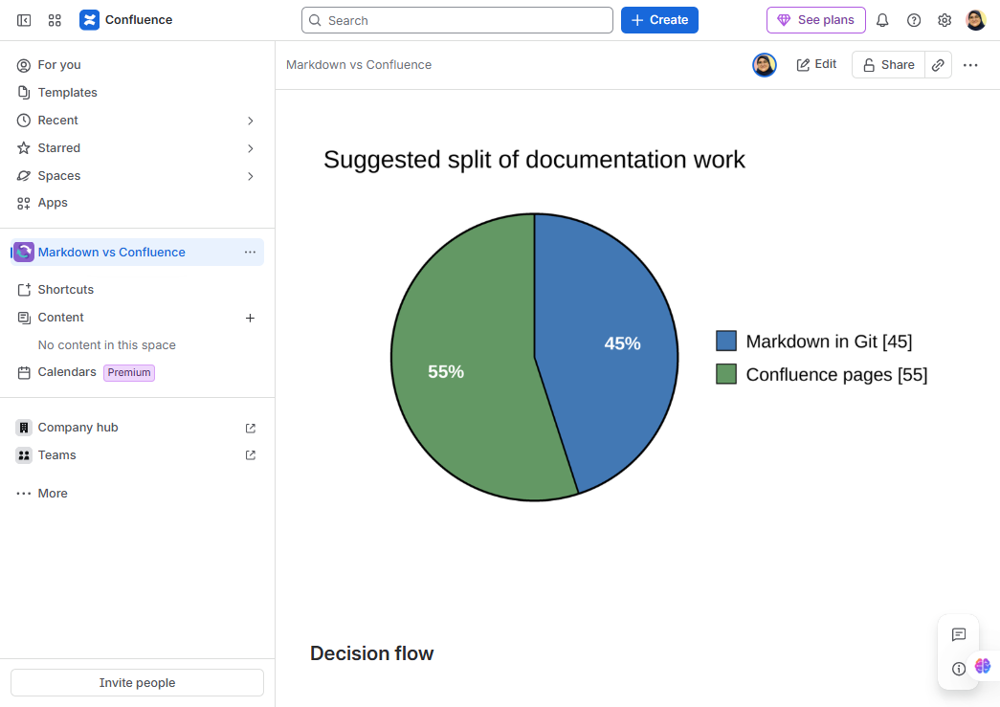

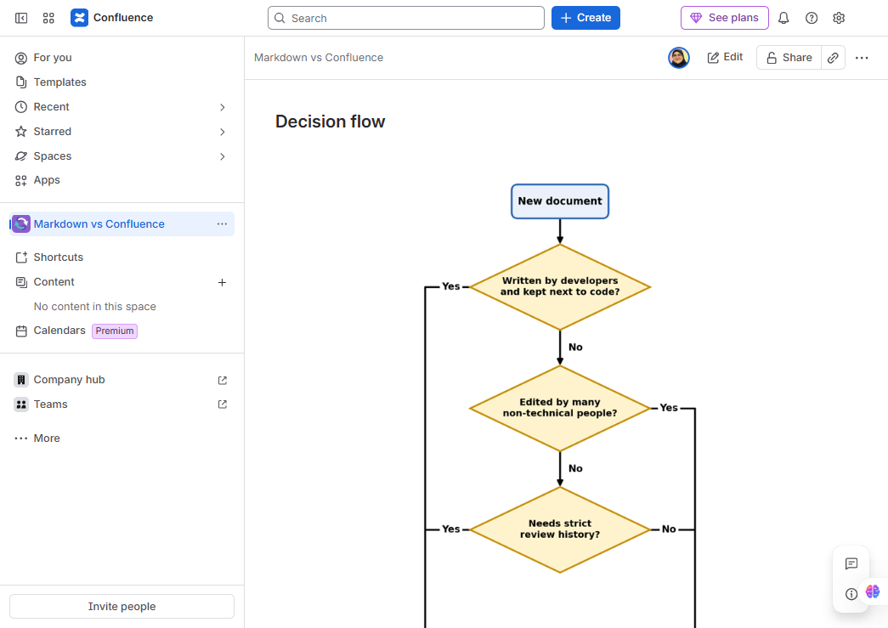

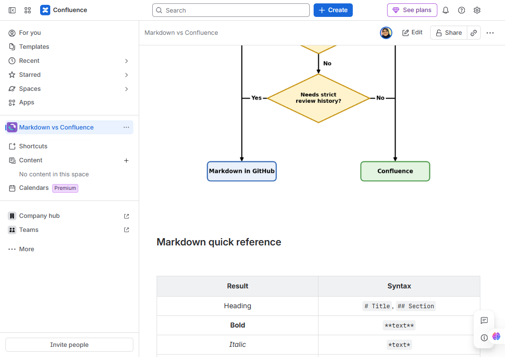

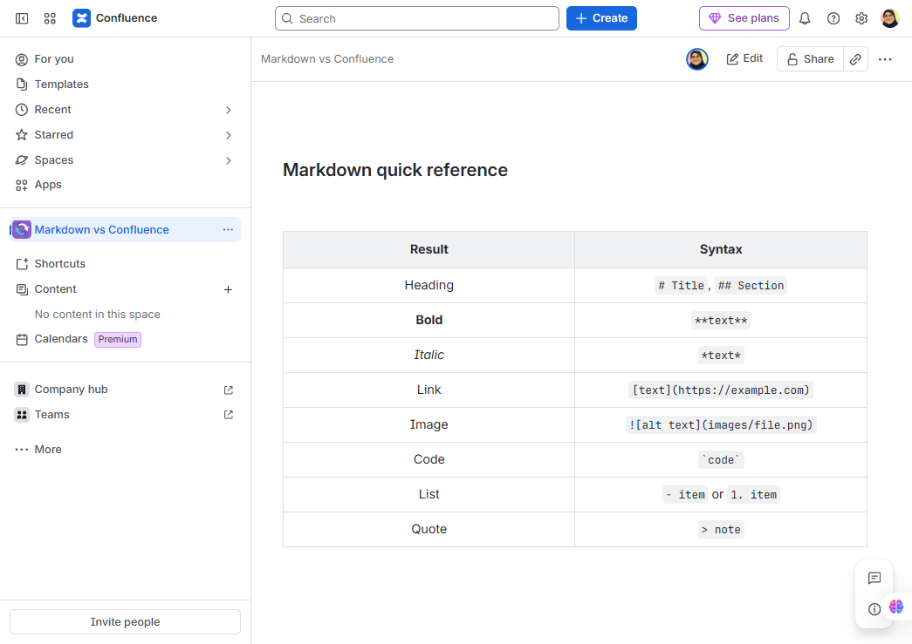

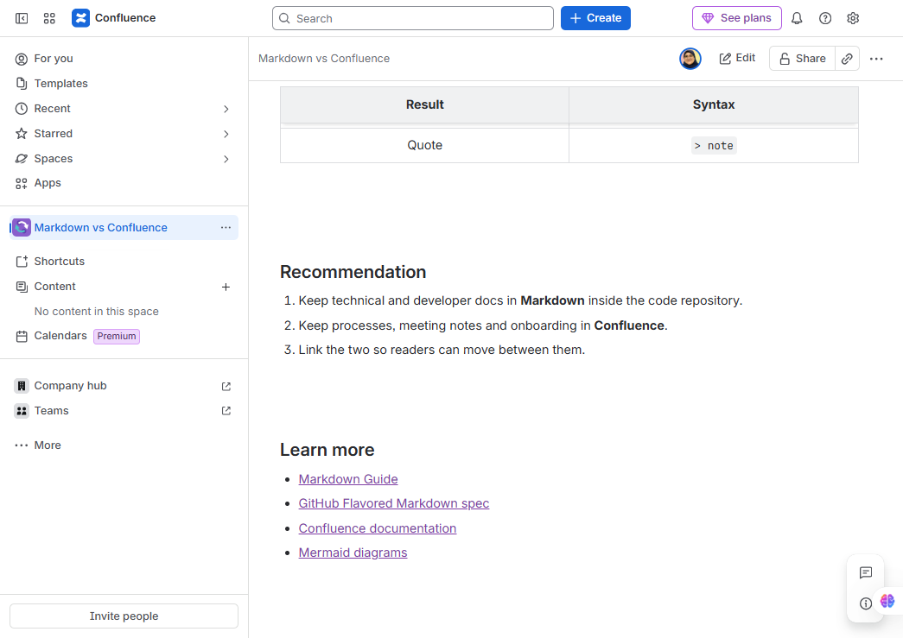
